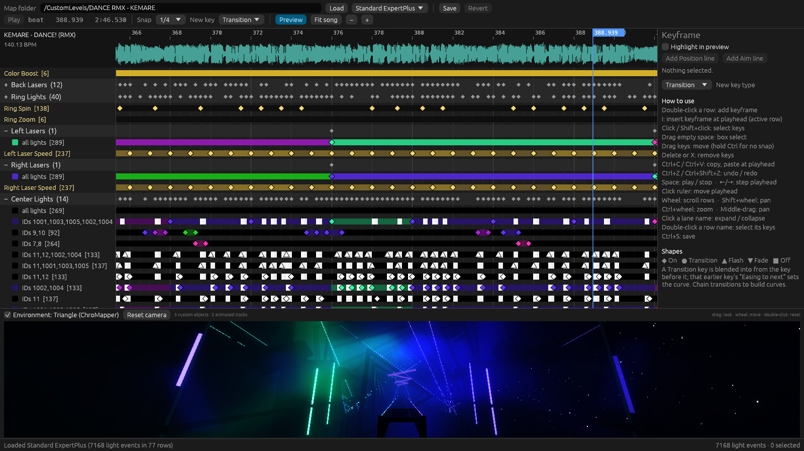
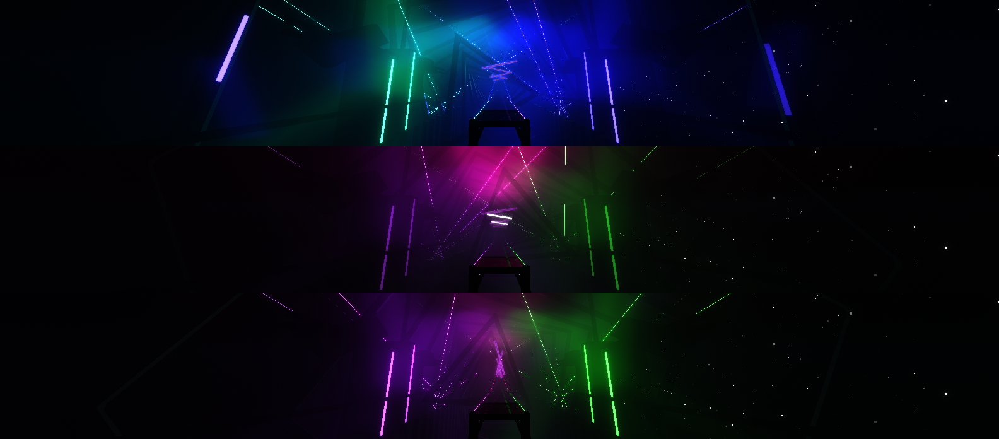

# Beat Saber Light Timeline

A Blender-style dope sheet for Beat Saber light events: one row per light lane (and per
Chroma light-ID group), keyframes you click, drag and recolor, with the song's waveform
and a live color preview strip under every row.

Works on v2 and v3 difficulties and v4 lightshows, including Chroma colors, light IDs, easings and
legacy Chroma RGB values. Everything it doesn't edit is written back exactly as it was.



New here? The **[tutorial](docs/TUTORIAL.md)** walks through lighting a section step by step.



## Run

```bash
cargo run --release -- "/path/to/Beat Saber_Data/CustomLevels/<map folder>"
```

The folder is the one containing `Info.dat`. The last folder is remembered.

The graphics driver needs Vulkan support. Developed and tested on Linux.

## Editing

| Action | How |
|---|---|
| Add keyframe | Double-click a row, or `I` to insert at the playhead on the active row |
| Select | Click, Shift+click, or drag a box in empty space |
| Move | Drag keys (snaps to the grid; hold Ctrl for free movement) |
| Edit | Right panel: type, base color, Chroma color, brightness, easing, HSV blend |
| Delete | `Delete` or `X` |
| Copy / paste | `Ctrl+C`, `Ctrl+V` (pastes at the playhead) |
| Undo / redo | `Ctrl+Z`, `Ctrl+Shift+Z` |
| Play | `Space`; click the ruler to move the playhead; `←`/`→` step |
| Navigate | Wheel scrolls rows, Shift+wheel pans, Ctrl+wheel zooms, middle-drag pans |
| Save | `Ctrl+S` |

The **Preview** panel at the bottom (toggle in the toolbar, drag its edge to resize) is a 3D
view from the player's spot at the playhead:

- **Environments from your ChroMapper**: run `tools/export-chromapper-envs.sh` once, and again after
  updating the editor if a preview feature needs new data (podman,
  dotnet and ChroMapper-PropPreview needed). It opens every environment in your installed
  ChroMapper (headless, in a container) and exports its meshes, materials, textures, light IDs,
  light components, fog lights and particles.
- **Rendered like ChroMapper**: the preview is a GPU port of ChroMapper's BloomFog rendering:
  light quads blurred into the fog texture (exposure knee and ACES), fog and height fog on every
  surface and the sky, ChroMapper's lit surfaces with its five environment lights, glowing
  (emissive) surfaces and flipbook screens, light tubes, glow sprites, fake glows, color-array
  glows, smoke and dust particles, mirror reflections, and the post bloom. Light colors come
  from the editor's ChroMapper-exact light model. Rotating and sliding lasers follow the
  laser-speed events, and rings follow the ring spin and zoom events (random angles, directions
  and phases differ from ChroMapper's unless the map sets them with Chroma). v3 light groups
  (color, rotation, translation and VFX, random filters included) move and light the stage as in
  ChroMapper, Unity constraints included.
- **Custom geometry from the map**: Chroma `environment` objects (cubes, spheres, cylinders,
  planes, quads, triangles) lit by your events and moved by `AnimateTrack`. They are drawn over the
  environment, not yet depth-tested against it.
- Not previewed: Lizzo's balloon bursts, Pyro's fire and Interscope's car jumps and suspension.
  ChroMapper doesn't show these either (its copies of those environments lack the parts that
  would), and the cars are a physics simulation. Also not previewed: audio-driven spectrograms,
  baked lightmaps, edits that move base-game objects, Vivify, track parenting. Without exported
  environments the preview falls back to a simple stand-in renderer.

Drag to look around, use the wheel to move, double-click to reset the camera.

Tick **Highlight in preview** in the Keyframe panel to see which lights you're editing: the selected
keys' lights get a white outline.

**Add Position line** and **Add Aim line** in the same panel add a line under a light group, with
keys that move its lights or set where they point. They're saved as Chroma track animations; see
the tutorial on [moving lights](docs/TUTORIAL.md#8-move-lights) and
[aiming lasers](docs/TUTORIAL.md#9-aim-lasers) for the limits.

The exported environments are kept in `~/.local/share/bs-light-timeline/environments/`, not in
this repository.

Yellow rows show the events that aren't light colors: color boost, ring spin and zoom, laser speed,
and special events. Rows at the bottom of the timeline show v3 light groups and Chroma fog and
component animation. Their keys edit like the others, with their own settings in the Keyframe panel.
The **Chroma Fog** row is there in every v2 and v3 map, so you can add fog to a map that has none.

Key shapes: ◆ On, ● Transition, ▲ Flash, ▼ Fade, ■ Off. A **Transition** key is blended into
from the key before it, and that earlier key's "Easing to next" sets the curve (this is how the
game and ChroMapper read it), so chained transitions work like animation curves.

The first save of a session copies the original file to `<file>.timeline-backup-<time>`.
Don't edit the same difficulty in ChroMapper at the same time: whichever saves last wins.

## Checking maps

```bash
cargo run --release -- --check "/path/to/CustomLevels" --audio
```

Loads every map read-only and verifies that saving would reproduce the same light events.

```bash
cargo run --release -- --save-test "<map folder>" /tmp/light-timeline-test
```

Copies a map's `.dat` files to the work folder, edits, saves and reloads the copy.

## Headless UI test (podman)

```bash
cargo build --release && test/run-ui-test.sh "/path/to/CustomLevels" /tmp/bslt-ui
```

Runs the real app on Xvfb inside a podman container (`test/Containerfile`) with the maps
mounted read-only, drives it with xdotool (`test/ui-steps.sh`: add, recolor, slider, save,
delete, undo) on a copy of one map, and writes screenshots to the output folder.

## Comparing with ChroMapper

```bash
test/compare-chromapper.sh <jobs.tsv> "/path/to/CustomLevels" test/out/all 2
cargo run --release -- --compare-lights "/path/to/CustomLevels" <jobs.tsv> test/out/all
```

Opens each map in your ChroMapper inside podman (memory and CPU capped; see the script) with the
probe plugin in `test/chromapper-probe`, records every light's color at a few beats, and compares
them with the editor's light model. `--plan-compare` writes a jobs file for a CustomLevels folder.

With `PROBE_FULL=1 CM_HIDE_NOTES=1` the probe also records the renderer state (shader globals, fog
lights, light blocks, particles, transforms, ChroMapper's fog texture). Then

```bash
cargo run --release -- --render-ref test/out/ref/<job>
python3 -I test/refcmp.py test/out/ref/<job>
```

renders each snapshot with ChroMapper's recorded light state and writes side-by-side images with
the mean error (`BSLT_FROM_LIGHTS=1` derives the shader inputs from the light colors instead).

```bash
cargo run --release -- --compare-motion "<map folder>" ExpertPlus test/out/ref/<job>
```

compares where ChroMapper moved each object (light groups, constraints, rotating and sliding lasers)
with where the editor's motion puts it (`BSLT_DEBUG=1` lists every object).

## License

GPL-2.0-only (see [LICENSE](LICENSE)). The light model (`src/cmlight.rs`) and the preview's
shader math (`src/gpu3d.wgsl`) are ports of [ChroMapper](https://github.com/Caeden117/ChroMapper),
which is licensed under GPL-2.0.
