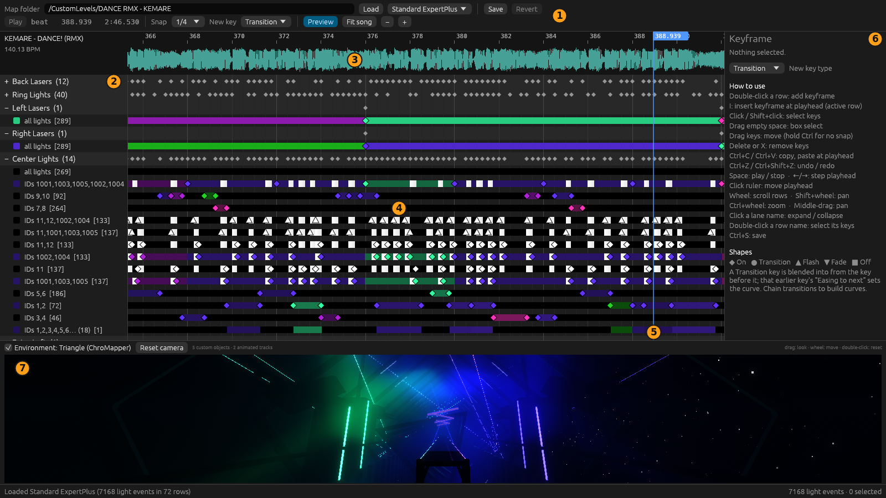
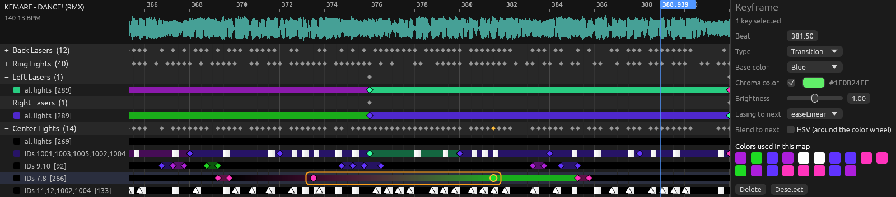
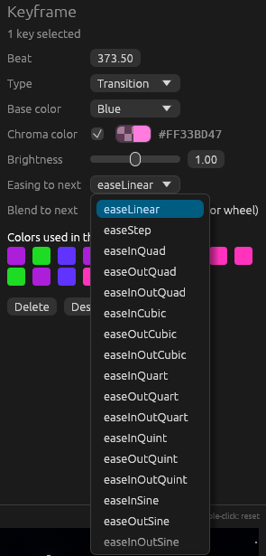
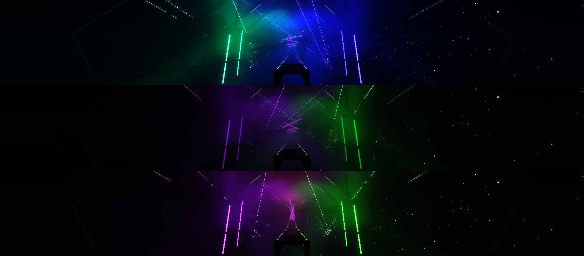
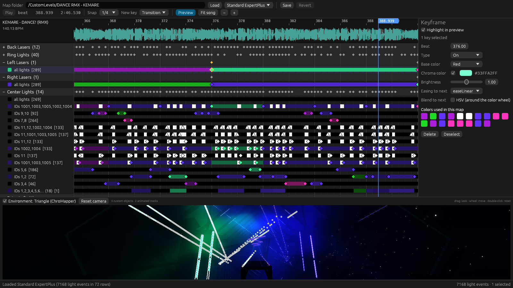
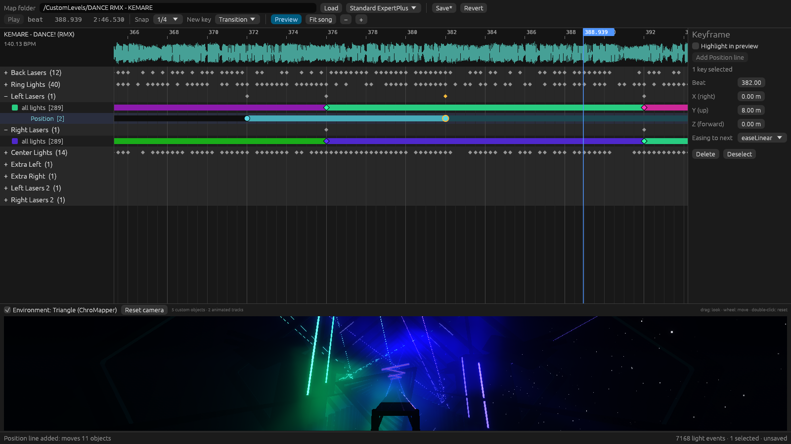
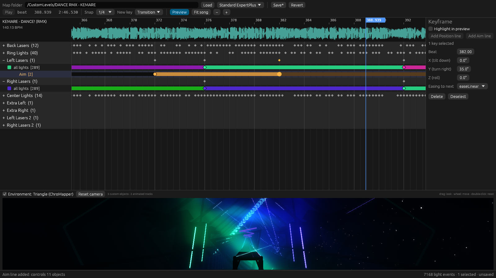

# Tutorial

This walks through lighting a section of a map: opening it, adding keyframes, fading between
colors, checking the result in the 3D preview and saving.

## Before you start

- A [Rust toolchain](https://rustup.rs) (1.95 or newer).
- A graphics driver with Vulkan support. On OpenGL-only setups the app crashes when it loads an
  exported environment.
- A map folder, the one containing `Info.dat`. v2 and v3 difficulty files both work.
- Optional, for the realistic preview: ChroMapper with the ChroMapper-PropPreview plugin, plus
  podman and dotnet. Run this once to export every environment from your ChroMapper:

  ```bash
  tools/export-chromapper-envs.sh
  ```

  Set `CHROMAPPER_DIR` if ChroMapper isn't in `~/Applications/chromapper`. Without this step the
  preview uses a simple stand-in stage.

## 1. Open a map

```bash
cargo run --release -- "/path/to/Beat Saber_Data/CustomLevels/<map folder>"
```

You can also paste the path into **Map folder** and press **Load**. The last folder is remembered.
Pick the difficulty from the dropdown next to **Load**.

## 2. Know the window



1. **Toolbar**: load, difficulty, save, play, snap, the type of new keys, the preview toggle, zoom.
2. **Lanes**: one per light lane. Click a name to expand or collapse it. `(12)` is how many rows the
   lane has.
3. **Waveform and ruler**: click the ruler to move the playhead.
4. **Rows**: each one holds keyframes, with the resulting color drawn behind them. `all lights`
   addresses the whole lane, and `IDs 7,8` only those Chroma light IDs. `[264]` is the key count.
5. **Playhead**: the moment shown in the preview.
6. **Keyframe panel**: edits the selected keys. With nothing selected it lists the controls.
7. **Preview**: the stage at the playhead, as seen from the player's position.

Key shapes show the event type: ◆ On, ● Transition, ▲ Flash, ▼ Fade, ■ Off.

## 3. Get around

| To | Do |
|---|---|
| See the whole song | **Fit song** |
| Zoom | `Ctrl`+wheel, or the **−** and **+** buttons |
| Pan in time | `Shift`+wheel, or middle-drag |
| Scroll through rows | Wheel |
| Play or stop | `Space` |
| Step the playhead | `←` and `→` |

## 4. Add keyframes

1. Set **Snap** (`1/4` is a good start) and choose the **New key** type.
2. Double-click a row where you want the key, or press `I` to insert one at the playhead on the
   active row.
3. The new key is selected, so the **Keyframe** panel on the right shows its settings.

## 5. Choose a color

In the **Keyframe** panel:

- **Base color** is the map's Blue, Red or White.
- **Chroma color** overrides it with any color. Untick the box to go back to the base color.
- **Colors used in this map** are one-click swatches, handy for staying on palette.
- **Brightness** scales the light.

## 6. Fade between two colors

A **Transition** key is blended into *from the key before it*.

1. Add a key and give it a color.
2. Add a second key later on the same row, with the type **Transition**, and give it another color.

The row now shows the fade:



To shape the fade, select the **first** key and set **Easing to next**. Tick **HSV** to blend around
the color wheel instead of straight between the two colors. Chain more Transition keys to build a
longer curve.



## 7. Check it in the preview

Click the ruler, step with `←` and `→`, or press `Space` to watch it with the music. The preview
shows the map's environment rendered like ChroMapper, with fog, bloom, reflections and moving
lasers:



Drag to look around, use the wheel to move, and double-click to reset the camera. **Preview** in the
toolbar hides or shows the panel, and you can drag its top edge to resize it.

### See which light you're editing

Tick **Highlight in preview** at the top of the **Keyframe** panel. The lights of the selected keys'
rows get a white outline, even while they're off, and keep their real colors. With no key selected,
it uses the active row, so you can click through rows to find out what each one controls.



## 8. Move lights

Each light group can have its own **Position** line.

1. Click a light row, such as `IDs 7,8` or `all lights`.
2. Press **Add Position line** in the **Keyframe** panel. The line appears right under that row.
3. Double-click the Position line to add keys. A new key starts where the lights are at that beat,
   so it doesn't move anything until you change it.
4. Set **X**, **Y** and **Z** in the panel. They're distances in metres from where the lights normally
   are: X to the right, Y up, Z forward.
5. Use **Easing to next** to shape the move, the same way as with colors.

The lights stay in place before the first key and hold the last key's offset after it. On the line,
a bright bar means the lights are moving and a dim bar means they're holding.



Moves are saved as Chroma track animations. Limits:

- The map must list Chroma as a requirement or suggestion. The editor warns you when saving if it
  doesn't.
- Chroma finds lights by object name, so lights that share a name can't be moved on their own. This
  rules out most ring lights. The status bar says how many lights a line can reach.
- A whole object moves, so if two light IDs are on one object, they move together.
- Saving needs the exported environment, because the game needs each light's position and name.
- This hasn't been tested inside Beat Saber yet. Object names come from ChroMapper's copy of each
  environment, so check the result in the game.

## 9. Aim lasers

An **Aim** line sets where a light group points, with exact angles.

1. Click a light row, such as `all lights` under Left Lasers.
2. Press **Add Aim line** in the **Keyframe** panel. The line appears under that row.
3. Double-click the Aim line to add keys, and set the angles in the panel:
   - **X** tilts the lights down (negative tilts them up).
   - **Y** turns them to the right (negative turns them left).
   - **Z** rolls them.
4. Use **Easing to next** to shape the sweep. Two keys 180° or more apart turn the short way, so add a
   key in the middle for a big sweep.

Angles are measured from how the lights normally point, so a fan of lasers stays a fan. The lights
are free before the first key, then follow the line and hold its last key.



Aim lines save the same way as Position lines and have the same limits. In addition:

- From its first key on, an aimed laser ignores laser-speed events in the preview. In the game the
  two may fight over the laser, so the editor warns you on save when aimed lasers also spin. Turn
  off the laser speed for those lasers during that stretch.

## 10. Rearrange

| Action | How |
|---|---|
| Select | Click, `Shift`+click, or drag a box in empty space |
| Select a whole row | Double-click its name |
| Move | Drag the keys (hold `Ctrl` to ignore snapping) |
| Copy, paste | `Ctrl+C`, `Ctrl+V` (pastes at the playhead) |
| Delete | `Delete` or `X` |
| Undo, redo | `Ctrl+Z`, `Ctrl+Shift+Z` |

## 11. Save

Press `Ctrl+S`. The **Save** button shows `Save*` while there are unsaved changes, and **Revert**
goes back to the last saved state.

The first save of a session copies the original file to `<file>.timeline-backup-<time>`. Everything
the editor doesn't handle is written back exactly as it was.

Don't edit the same difficulty in ChroMapper at the same time: whichever saves last wins.
